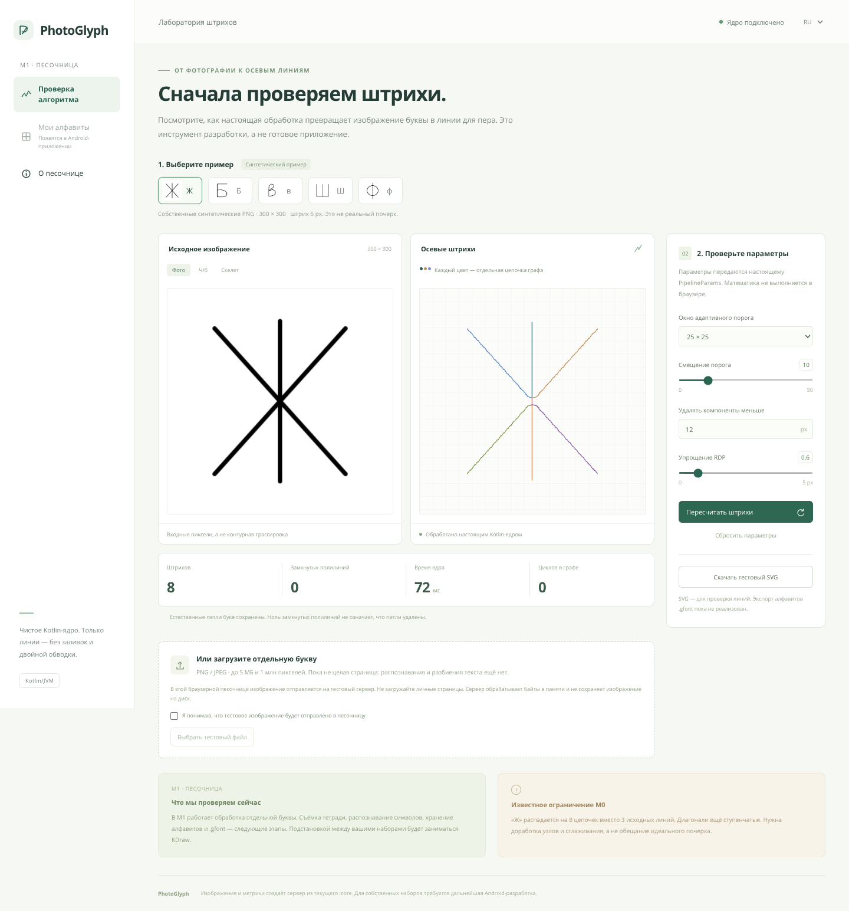

# M1 — каркас, CI и настоящая песочница

Дата: **2026-10-13**. Этапы M2–M10 **не начаты**. Минимальный Android — API 26 (Android 8.0). Браузерная лаборатория — отдельный инструмент разработки, а не Android-приложение или генератор готового `.gfont`.

**Результат:** действующая песочница на порту 8080, настоящий Compose-каркас и зелёная полная Gradle-сборка в GitHub Actions, включая **пустой коммит `eaeb99b`**. Локальный обязательный Gradle-прогон был выполнен, но не прошёл загрузку дистрибутива из-за TLS/network policy; не заявляется зелёным. Реальные дополнительные проверки выполнялись здесь отдельно и не выдаются за Android-сборку.

[CI на пустом коммите](https://github.com/evzhem/photo-to-glyph/actions/runs/38439241310). [Debug APK из этого прогона](https://github.com/evzhem/photo-to-glyph/actions/runs/38439241310/artifacts/11833774960) — артефакт каркаса M1, **не релиз готового приложения**. Размер ZIP-артефакта по GitHub API — 8 913 912 байт; размер самого APK здесь отдельно не измерялся.

## 1) Что сделано: файлы и назначение

- `settings.gradle.kts`, `build.gradle.kts`, `gradle.properties`, `gradle/libs.versions.toml` — настоящие модули `:core/:app/:cli/:tools`, закреплённые Kotlin 2.1.21 / AGP 8.7.3 / Gradle 8.11.1, единая сборка и проверки.
- `gradlew`, `gradlew.bat`, `gradle/wrapper/gradle-wrapper.jar`, `gradle-wrapper.properties` — **официальные tool-generated wrapper-компоненты Gradle**, не заглушка; SHA-256 JAR и дистрибутива проверяются. Wrapper — стандартный Apache-2.0 build-инструмент, не скопированный алгоритм продукта.
- `core/build.gradle.kts`, `cli/build.gradle.kts`, `app/build.gradle.kts`, `tools/build.gradle.kts` — JVM/Android-сборка, JUnit, `:cli:smoke`, `:cli:sandbox`, проверка воспроизводимых фикстур.
- `config/detekt.yml`, `.editorconfig` — ktlint/detekt с работающими проверками. Узкие исключения для трёх уже существующих функциональных M0-файлов (имя алгоритма вместо result DTO, математические predicates/early continue) и Compose PascalCase. Это не выключение всех проверок; алгоритмы M0 ради линтера не переписаны. Изменения M0 — механическое форматирование/порядок imports, точные PNG-golden и поведение тестов сохранены.
- `.github/workflows/ci.yml` — `build :core:test :cli:smoke`, checksum wrapper, полный stdout/stderr в Checks без обрезания, test/smoke-артефакты и debug APK. Неуспешные промежуточные проверки реально падали. Formatter-предложения имели только neutral-статус и не превращали failed build в успех.
- `core/src/main/kotlin/photoglyph/core/CoreSourcePolicy.kt`, `CoreImportViolation.kt` — реальная чистая `findForbiddenAndroidImports`; различает код, комментарии, строки, вложенные comments и `androidx`.
- `core/src/test/kotlin/photoglyph/core/{CoreSourcePolicyTest,CoreSourcePolicyChecks,LegacyCoreSuiteTest}.kt` — архитектурный тест реальных core-файлов и JUnit-мост к исходным 21 проверкам M0 без копий математики.
- `app/src/main/AndroidManifest.xml`, `app/src/main/kotlin/photoglyph/app/MainActivity.kt`, `app/src/main/res/{values,values-ru}/strings.xml` — Compose UI, без XML-layout. Кнопка на нашей synthetic «Ж» реально вызывает `vectorize`, Canvas рисует результат штрихами. Библиотека/экспорт явно обозначены как ещё не реализованные. CameraX/Room не подключены преждевременно.
- `cli/src/main/kotlin/photoglyph/cli/Main.kt`, `sandbox/SandboxServer.kt` — HTTP-адаптер стандартного JVM API, адрес **0.0.0.0**, whitelist маршрутов, PNG/JPEG header/pixel/body limits, ограниченная параллельная обработка, `vectorize → strokesToSvg → requireStrokeOnlySvg`. Пользовательские байты/PNG обрабатываются в памяти, не записываются в Git/на диск; имена файлов серверу не передаются.
- `cli/src/main/resources/sandbox/{index.html,app.css,app.js,ru/strings.xml,en/strings.xml}` — рабочий browser workbench, все подписи ru/en из `strings.xml`, только relative API URLs; никакой копии алгоритма на JS. Цвета в превью не изменяют скачиваемую геометрию/SVG.
- `cli/src/test/kotlin/photoglyph/cli/sandbox/{SandboxApiTest,SandboxApiChecks}.kt` — 8 HTTP/integration/recovery-сценариев, реальные core-результаты, ошибки входа и последующая восстановленная обработка.
- `tools/{build-sandbox.sh,m1-standalone-check.sh,M1StandaloneTests.kt,sandbox-browser-check.mjs}` — независимые дополнительные проверки теми же телами тестов, без ложного Gradle/Android-success; настоящая браузерная QA, desktop/mobile, согласие/загрузка/скачивание.
- `tools/m0-check.sh` — совместимость архивной M0-команды: компилирует исходную 21-case suite, а не новые JUnit adapters без их зависимостей.
- `docs/03-песочница.md` — инструкция и ограничения; `docs/M1-report.md` — этот отчёт; `docs/m1/` — точные logs и screenshot исключительно наших synthetic данных.
- `README.md`, `ROADMAP.md`, `AGENTS.md`, `CHANGELOG.md`, `.gitignore` — статус, подтверждённый API 26, пути запуска, запись этапа и исключение локальных tool/build-артефактов.



Песочница ещё **не** определяет символ на загруженной форме, не режет целую тетрадь, не сохраняет реальные алфавиты и не экспортирует `.gfont`. Выбираемые пять примеров подписаны по заранее известным собственным файлам, не выдаются за OCR.

## 2) Полный вывод реально выполненных команд

### Локальный обязательный Gradle-прогон — failure, не скрывается

```sh
JAVA_HOME="$PWD/.cache/m0-toolchain/java/jdk4py/java-runtime" \
GRADLE_USER_HOME="$PWD/.cache/gradle" ./gradlew build :core:test :cli:smoke
```

Exit code **1**, до конфигурации/тестов. Полный объединённый stdout/stderr:

```text
Downloading https://services.gradle.org/distributions/gradle-8.11.1-bin.zip

Exception in thread "main" javax.net.ssl.SSLHandshakeException: Remote host terminated the handshake
	at java.base/sun.security.ssl.SSLSocketImpl.handleEOF(Unknown Source)
	at java.base/sun.security.ssl.SSLSocketImpl.decode(Unknown Source)
	at java.base/sun.security.ssl.SSLSocketImpl.readHandshakeRecord(Unknown Source)
	at java.base/sun.security.ssl.SSLSocketImpl.startHandshake(Unknown Source)
	at java.base/sun.security.ssl.SSLSocketImpl.startHandshake(Unknown Source)
	at java.base/sun.net.www.protocol.https.HttpsClient.afterConnect(Unknown Source)
	at java.base/sun.net.www.protocol.https.AbstractDelegateHttpsURLConnection.connect(Unknown Source)
	at java.base/sun.net.www.protocol.http.HttpURLConnection.getInputStream0(Unknown Source)
	at java.base/sun.net.www.protocol.http.HttpURLConnection.getInputStream(Unknown Source)
	at java.base/sun.net.www.protocol.https.HttpsURLConnectionImpl.getInputStream(Unknown Source)
	at org.gradle.wrapper.Install.forceFetch(SourceFile:2)
	at org.gradle.wrapper.Install$1.call(SourceFile:8)
	at org.gradle.wrapper.GradleWrapperMain.main(SourceFile:67)
Caused by: java.io.EOFException: SSL peer shut down incorrectly
	at java.base/sun.security.ssl.SSLSocketInputRecord.read(Unknown Source)
	at java.base/sun.security.ssl.SSLSocketInputRecord.readHeader(Unknown Source)
	at java.base/sun.security.ssl.SSLSocketInputRecord.decode(Unknown Source)
	at java.base/sun.security.ssl.SSLTransport.decode(Unknown Source)
	... 12 more
```

### Настоящий CI build/test/smoke — success на пустом коммите

Команда runner с Temurin JDK 17 и Android SDK:

```sh
./gradlew --console=plain --no-daemon build :core:test :cli:smoke
```

Exit code **0**, commit `eaeb99b891c01249162e46262f9107e8143a47ee`, [run 38439241310](https://github.com/evzhem/photo-to-glyph/actions/runs/38439241310). `git show --stat eaeb99b` показывает отсутствие файловых изменений; build/test реально повторены. Ниже полный log, не выдержка:

```text
Downloading https://services.gradle.org/distributions/gradle-8.11.1-bin.zip
.............10%.............20%.............30%.............40%.............50%.............60%.............70%.............80%.............90%.............100%

Welcome to Gradle 8.11.1!

Here are the highlights of this release:
 - Parallel load and store for Configuration Cache
 - Java compilation errors at the end of the build output
 - Consolidated report for warnings and deprecations

For more details see https://docs.gradle.org/8.11.1/release-notes.html

To honour the JVM settings for this build a single-use Daemon process will be forked. For more on this, please refer to https://docs.gradle.org/8.11.1/userguide/gradle_daemon.html#sec:disabling_the_daemon in the Gradle documentation.
Daemon will be stopped at the end of the build 
> Task :assemble UP-TO-DATE
> Task :app:detekt
> Task :core:checkKotlinGradlePluginConfigurationErrors SKIPPED
> Task :app:loadKtlintReporters
> Task :app:runKtlintCheckOverAndroidTestDebugSourceSet NO-SOURCE
> Task :app:ktlintAndroidTestDebugSourceSetCheck SKIPPED
> Task :app:runKtlintCheckOverAndroidTestReleaseSourceSet NO-SOURCE
> Task :app:ktlintAndroidTestReleaseSourceSetCheck SKIPPED
> Task :app:runKtlintCheckOverAndroidTestSourceSet NO-SOURCE
> Task :app:ktlintAndroidTestSourceSetCheck SKIPPED
> Task :app:runKtlintCheckOverDebugSourceSet NO-SOURCE
> Task :app:ktlintDebugSourceSetCheck SKIPPED
> Task :app:runKtlintCheckOverKotlinScripts
> Task :app:ktlintKotlinScriptCheck
> Task :app:runKtlintCheckOverMainSourceSet
> Task :app:ktlintMainSourceSetCheck
> Task :app:runKtlintCheckOverReleaseSourceSet NO-SOURCE
> Task :app:ktlintReleaseSourceSetCheck SKIPPED
> Task :app:runKtlintCheckOverTestDebugSourceSet NO-SOURCE
> Task :app:ktlintTestDebugSourceSetCheck SKIPPED
> Task :app:runKtlintCheckOverTestFixturesDebugSourceSet NO-SOURCE
> Task :app:ktlintTestFixturesDebugSourceSetCheck SKIPPED
> Task :app:runKtlintCheckOverTestFixturesReleaseSourceSet NO-SOURCE
> Task :app:ktlintTestFixturesReleaseSourceSetCheck SKIPPED
> Task :app:runKtlintCheckOverTestFixturesSourceSet NO-SOURCE
> Task :app:ktlintTestFixturesSourceSetCheck SKIPPED
> Task :app:runKtlintCheckOverTestReleaseSourceSet NO-SOURCE
> Task :app:ktlintTestReleaseSourceSetCheck SKIPPED
> Task :app:runKtlintCheckOverTestSourceSet NO-SOURCE
> Task :app:ktlintTestSourceSetCheck SKIPPED
> Task :core:processResources NO-SOURCE
> Task :app:checkKotlinGradlePluginConfigurationErrors SKIPPED
> Task :app:preBuild UP-TO-DATE
> Task :app:preDebugBuild UP-TO-DATE
> Task :core:compileKotlin
> Task :core:compileJava NO-SOURCE
> Task :core:classes UP-TO-DATE
> Task :app:checkDebugAarMetadata
> Task :core:jar
> Task :app:generateDebugResValues
> Task :app:mapDebugSourceSetPaths
> Task :app:generateDebugResources
> Task :app:mergeDebugResources
> Task :app:packageDebugResources
> Task :app:parseDebugLocalResources
> Task :app:createDebugCompatibleScreenManifests
> Task :app:extractDeepLinksDebug
> Task :app:processDebugMainManifest
> Task :app:processDebugManifest
> Task :app:processDebugManifestForPackage
> Task :app:javaPreCompileDebug
> Task :app:preDebugAndroidTestBuild SKIPPED
> Task :app:generateDebugAndroidTestResValues
> Task :app:extractProguardFiles
> Task :app:preDebugUnitTestBuild UP-TO-DATE
> Task :app:javaPreCompileDebugUnitTest
> Task :app:buildKotlinToolingMetadata
> Task :app:preReleaseBuild UP-TO-DATE
> Task :app:checkReleaseAarMetadata
> Task :app:generateReleaseResValues
> Task :app:mapReleaseSourceSetPaths
> Task :app:generateReleaseResources
> Task :app:processDebugResources
> Task :app:mergeReleaseResources
> Task :app:packageReleaseResources
> Task :app:parseReleaseLocalResources
> Task :app:createReleaseCompatibleScreenManifests
> Task :app:extractDeepLinksRelease
> Task :app:processReleaseMainManifest
> Task :app:processReleaseManifest
> Task :app:processReleaseManifestForPackage
> Task :app:processReleaseResources
> Task :app:compileDebugKotlin
> Task :app:compileReleaseKotlin
> Task :app:compileDebugJavaWithJavac NO-SOURCE
> Task :app:bundleDebugClassesToCompileJar
> Task :app:generateDebugLintReportModel
> Task :app:generateDebugAndroidTestLintModel
> Task :app:generateDebugUnitTestLintModel
> Task :app:lintAnalyzeDebugAndroidTest
> Task :app:lintAnalyzeDebugUnitTest
> Task :app:bundleDebugClassesToRuntimeJar
> Task :app:compileDebugUnitTestKotlin NO-SOURCE
> Task :app:compileDebugUnitTestJavaWithJavac NO-SOURCE
> Task :app:processDebugJavaRes
> Task :app:processDebugUnitTestJavaRes NO-SOURCE
> Task :app:testDebugUnitTest NO-SOURCE
> Task :app:javaPreCompileRelease
> Task :app:compileReleaseJavaWithJavac NO-SOURCE
> Task :app:bundleReleaseClassesToRuntimeJar
> Task :app:bundleReleaseClassesToCompileJar
> Task :app:compileReleaseUnitTestKotlin NO-SOURCE
> Task :app:preReleaseUnitTestBuild UP-TO-DATE
> Task :app:javaPreCompileReleaseUnitTest
> Task :app:compileReleaseUnitTestJavaWithJavac NO-SOURCE
> Task :app:processReleaseJavaRes
> Task :app:processReleaseUnitTestJavaRes NO-SOURCE
> Task :app:testReleaseUnitTest NO-SOURCE
> Task :app:test UP-TO-DATE
> Task :cli:detekt
> Task :cli:loadKtlintReporters
> Task :cli:runKtlintCheckOverKotlinScripts
> Task :cli:ktlintKotlinScriptCheck
> Task :cli:runKtlintCheckOverMainSourceSet
> Task :cli:ktlintMainSourceSetCheck
> Task :cli:runKtlintCheckOverTestSourceSet
> Task :cli:ktlintTestSourceSetCheck
> Task :cli:checkKotlinGradlePluginConfigurationErrors SKIPPED
> Task :cli:compileKotlin
> Task :cli:compileJava NO-SOURCE
> Task :cli:processResources
> Task :cli:classes
> Task :cli:jar
> Task :cli:compileTestKotlin
> Task :cli:compileTestJava NO-SOURCE
> Task :cli:processTestResources NO-SOURCE
> Task :cli:testClasses UP-TO-DATE
> Task :app:lintAnalyzeDebug

> Task :cli:test

SandboxApiTest > oversizedInputsReleaseTheCoreForRecovery PASSED

SandboxApiTest > fiveFixturesExecuteActualCore PASSED

SandboxApiTest > uploadedPngExecutesActualCore PASSED

SandboxApiTest > invalidParametersReleaseTheCoreForRecovery PASSED

SandboxApiTest > badImagesReleaseTheCoreForRecovery PASSED

SandboxApiTest > uploadedJpegExecutesActualCore PASSED

SandboxApiTest > routesAndLocalesPreserveAWorkingCore PASSED

SandboxApiTest > parameterChangesReachActualCore PASSED

> Task :cli:check

> Task :app:lintReportDebug
Wrote HTML report to file:///home/runner/work/photo-to-glyph/photo-to-glyph/app/build/reports/lint-results-debug.html

> Task :core:detekt
> Task :app:lintDebug
> Task :app:lint
> Task :app:check
> Task :core:loadKtlintReporters
> Task :core:runKtlintCheckOverKotlinScripts
> Task :core:ktlintKotlinScriptCheck
> Task :core:runKtlintCheckOverMainSourceSet
> Task :core:ktlintMainSourceSetCheck
> Task :core:runKtlintCheckOverTestSourceSet
> Task :core:ktlintTestSourceSetCheck
> Task :core:processTestResources NO-SOURCE
> Task :tools:detekt NO-SOURCE
> Task :tools:loadKtlintReporters
> Task :tools:runKtlintCheckOverKotlinScripts
> Task :tools:ktlintKotlinScriptCheck
> Task :core:compileTestKotlin

> Task :tools:verifyFixtures
PASS fixture: tools/fixtures/synthetic/m0/1046.png
PASS fixture: tools/fixtures/synthetic/m0/1041.png
PASS fixture: tools/fixtures/synthetic/m0/1074.png
PASS fixture: tools/fixtures/synthetic/m0/1064.png
PASS fixture: tools/fixtures/synthetic/m0/1092.png
PASS fixture: tools/fixtures/synthetic/m0/manifest.json
PASS fixture: tools/fixtures/synthetic/golden/bar-20-input.png
PASS fixture: tools/fixtures/synthetic/golden/bar-20-expected.png

> Task :core:compileTestJava NO-SOURCE
> Task :core:testClasses UP-TO-DATE

> Task :core:test

CoreSourcePolicyTest > actualProductionSourcesHaveNoAndroidImports PASSED

CoreSourcePolicyTest > ignoresNestedCommentsAndStringExamples PASSED

CoreSourcePolicyTest > rejectsQualifiedWildcardAndAliasedAndroidImports PASSED

LegacyCoreSuiteTest > runThe21ExistingProductionCoreChecks STANDARD_OUT
    PASS GrayscaleTest.bt601 -> toGrayscale
    PASS GrayscaleTest.alphaOnWhite -> toGrayscale
    PASS AdaptiveThresholdTest.localMeanAndOffset -> adaptiveThreshold
    PASS AdaptiveThresholdTest.clippedBorderWindow -> adaptiveThreshold
    PASS DespeckleTest.strict12pxBoundary -> removeSmallComponents
    PASS DespeckleTest.eightConnectivity -> removeSmallComponents
    PASS ZhangSuenTest.golden20px -> zhangSuen
    PASS ZhangSuenTest.fixedPointAndBorder -> zhangSuen
    PASS ZhangSuenTest.preserveLoop -> zhangSuen, skeletonToPolylines
    PASS SkeletonToPolylinesTest.zheAtLeast3Open -> vectorize, skeletonToPolylines
    PASS SkeletonToPolylinesTest.cornerAndDiagonal -> skeletonToPolylines
    PASS SkeletonToPolylinesTest.cycleEdgeCoverage -> skeletonToPolylines
    PASS SkeletonToPolylinesTest.pruneStrictlyBelow2px -> skeletonToPolylines
    PASS SkeletonToPolylinesTest.dotAndEmpty -> skeletonToPolylines, strokesToSvg, requireStrokeOnlySvg
    PASS RdpTest.handSpecifiedSimplification -> simplifyRdp
    PASS RdpTest.zeroEpsilonAndShortPaths -> simplifyRdp
    PASS SvgNoFillTest.fiveActualExports -> vectorize, strokesToSvg, requireStrokeOnlySvg
    PASS SvgNoFillTest.rejectCorruptedExport -> strokesToSvg, requireStrokeOnlySvg
    PASS SvgNoFillTest.rejectClosureAndUseDecimalPoint -> strokesToSvg, requireStrokeOnlySvg
    PASS PipelineTest.deterministicAndImmutable -> vectorize
    PASS PipelineTest.blankImage -> vectorize, strokesToSvg, requireStrokeOnlySvg
    Tests: 21, passed: 21, failed: 0

LegacyCoreSuiteTest > runThe21ExistingProductionCoreChecks PASSED

> Task :core:check
> Task :tools:check
> Task :check
> Task :app:mergeDebugNativeDebugMetadata NO-SOURCE
> Task :app:mergeDebugShaders
> Task :app:compileDebugShaders NO-SOURCE
> Task :app:generateDebugAssets UP-TO-DATE
> Task :app:mergeDebugAssets
> Task :app:desugarDebugFileDependencies
> Task :app:compressDebugAssets
> Task :app:dexBuilderDebug
> Task :app:mergeDebugGlobalSynthetics
> Task :app:checkDebugDuplicateClasses
> Task :app:mergeDebugJavaResource
> Task :app:mergeExtDexDebug
> Task :app:mergeLibDexDebug
> Task :app:mergeDebugJniLibFolders
> Task :app:mergeProjectDexDebug
> Task :app:mergeDebugNativeLibs
> Task :app:validateSigningDebug
> Task :app:writeDebugAppMetadata
> Task :app:writeDebugSigningConfigVersions

> Task :app:stripDebugDebugSymbols
Unable to strip the following libraries, packaging them as they are: libandroidx.graphics.path.so.

> Task :app:generateReleaseLintVitalReportModel
> Task :app:packageDebug
> Task :app:createDebugApkListingFileRedirect
> Task :app:assembleDebug
> Task :app:mergeReleaseJniLibFolders
> Task :app:mergeReleaseNativeLibs

> Task :app:stripReleaseDebugSymbols
Unable to strip the following libraries, packaging them as they are: libandroidx.graphics.path.so.

> Task :app:extractReleaseNativeSymbolTables
> Task :app:mergeReleaseNativeDebugMetadata NO-SOURCE
> Task :app:checkReleaseDuplicateClasses
> Task :app:dexBuilderRelease
> Task :app:desugarReleaseFileDependencies
> Task :app:mergeReleaseStartupProfile
> Task :app:lintVitalAnalyzeRelease
> Task :app:lintVitalReportRelease SKIPPED
> Task :app:lintVitalRelease SKIPPED
> Task :app:mergeReleaseArtProfile
> Task :app:mergeExtDexRelease
> Task :app:mergeReleaseGlobalSynthetics
> Task :app:mergeReleaseShaders
> Task :app:compileReleaseShaders NO-SOURCE
> Task :app:generateReleaseAssets UP-TO-DATE
> Task :app:mergeReleaseAssets
> Task :app:compressReleaseAssets
> Task :app:mergeDexRelease
> Task :app:extractReleaseVersionControlInfo
> Task :app:mergeReleaseJavaResource
> Task :app:optimizeReleaseResources
> Task :app:collectReleaseDependencies
> Task :app:sdkReleaseDependencyData
> Task :app:writeReleaseAppMetadata
> Task :app:writeReleaseSigningConfigVersions
> Task :cli:startScripts
> Task :app:compileReleaseArtProfile
> Task :cli:distTar
> Task :cli:distZip
> Task :cli:assemble
> Task :cli:build
> Task :core:assemble
> Task :core:build
> Task :tools:assemble UP-TO-DATE
> Task :tools:build

> Task :cli:smoke
INPUT: original synthetic 300x300 PNGs, 6 px strokes; not real handwriting
TIMING: PNG decode + core + SVG serialization/validation; excludes JVM startup/output writes; 2 warmups + 5 measured runs
char | strokes | closed | graph cycles | split chains | cold ms | median ms | max ms
Ж | 8 | 0 | 0 | 0 | 532.894 | 25.850 | 532.894
Б | 3 | 0 | 1 | 1 | 15.480 | 12.258 | 15.480
в | 3 | 0 | 2 | 0 | 10.528 | 11.412 | 13.493
Ш | 3 | 0 | 0 | 0 | 8.911 | 8.378 | 9.654
ф | 5 | 0 | 2 | 0 | 10.176 | 9.074 | 10.176
PASS smoke: 5/5 nonempty glyphs, zero closed polylines, explicit no-fill strokes, within budget
Outputs: /home/runner/work/photo-to-glyph/photo-to-glyph/cli/build/smoke/<codepoint>.svg, intermediate PNGs, metrics.csv

> Task :app:packageRelease
> Task :app:createReleaseApkListingFileRedirect
> Task :app:assembleRelease
> Task :app:assemble
> Task :app:build
> Task :build
gradle/actions: Writing build results to /home/runner/work/_temp/.gradle-actions/build-results/verification-1791912662080.json

BUILD SUCCESSFUL in 4m 5s
134 actionable tasks: 134 executed
```

`NO-SOURCE` у Java/ещё отсутствующих Android test source sets не означает выполненных тестов. Реальные JUnit-методы перечислены в выводе `:core:test` и `:cli:test`; Android runtime этим не проверен.

### Дополнительная самостоятельная проверка здесь — не Gradle/Android

```sh
./tools/m1-standalone-check.sh
```

Exit code **0**. Тестовые тела компилируются **против production JAR**, не собственной версии алгоритма:

```text
=== Compile the actual Kotlin core + diagnostic CLI (not Android/Gradle) ===
info: kotlinc-jvm 2.1.21 (JRE 21.0.8+9-LTS)
PASS embedded sandbox resources (HTML/CSS/JS and ru/en strings.xml)
PASS diagnostic production compilation
PASS fixture: tools/fixtures/synthetic/m0/1046.png
PASS fixture: tools/fixtures/synthetic/m0/1041.png
PASS fixture: tools/fixtures/synthetic/m0/1074.png
PASS fixture: tools/fixtures/synthetic/m0/1064.png
PASS fixture: tools/fixtures/synthetic/m0/1092.png
PASS fixture: tools/fixtures/synthetic/m0/manifest.json
PASS fixture: tools/fixtures/synthetic/golden/bar-20-input.png
PASS fixture: tools/fixtures/synthetic/golden/bar-20-expected.png

=== Compile shared real test cases against the production JAR ===

=== Execute unchanged M0 + source policy + HTTP/core recovery checks ===
PASS GrayscaleTest.bt601 -> toGrayscale
PASS GrayscaleTest.alphaOnWhite -> toGrayscale
PASS AdaptiveThresholdTest.localMeanAndOffset -> adaptiveThreshold
PASS AdaptiveThresholdTest.clippedBorderWindow -> adaptiveThreshold
PASS DespeckleTest.strict12pxBoundary -> removeSmallComponents
PASS DespeckleTest.eightConnectivity -> removeSmallComponents
PASS ZhangSuenTest.golden20px -> zhangSuen
PASS ZhangSuenTest.fixedPointAndBorder -> zhangSuen
PASS ZhangSuenTest.preserveLoop -> zhangSuen, skeletonToPolylines
PASS SkeletonToPolylinesTest.zheAtLeast3Open -> vectorize, skeletonToPolylines
PASS SkeletonToPolylinesTest.cornerAndDiagonal -> skeletonToPolylines
PASS SkeletonToPolylinesTest.cycleEdgeCoverage -> skeletonToPolylines
PASS SkeletonToPolylinesTest.pruneStrictlyBelow2px -> skeletonToPolylines
PASS SkeletonToPolylinesTest.dotAndEmpty -> skeletonToPolylines, strokesToSvg, requireStrokeOnlySvg
PASS RdpTest.handSpecifiedSimplification -> simplifyRdp
PASS RdpTest.zeroEpsilonAndShortPaths -> simplifyRdp
PASS SvgNoFillTest.fiveActualExports -> vectorize, strokesToSvg, requireStrokeOnlySvg
PASS SvgNoFillTest.rejectCorruptedExport -> strokesToSvg, requireStrokeOnlySvg
PASS SvgNoFillTest.rejectClosureAndUseDecimalPoint -> strokesToSvg, requireStrokeOnlySvg
PASS PipelineTest.deterministicAndImmutable -> vectorize
PASS PipelineTest.blankImage -> vectorize, strokesToSvg, requireStrokeOnlySvg
Tests: 21, passed: 21, failed: 0
PASS CoreSourcePolicyTest.actualProductionSourcesHaveNoAndroidImports -> findForbiddenAndroidImports
PASS CoreSourcePolicyTest.rejectsQualifiedWildcardAndAliasedAndroidImports -> findForbiddenAndroidImports
PASS CoreSourcePolicyTest.ignoresNestedCommentsAndStringExamples -> findForbiddenAndroidImports
PASS SandboxApiTest.fiveFixturesExecuteActualCore -> HTTP + vectorize, strokesToSvg, requireStrokeOnlySvg
PASS SandboxApiTest.parameterChangesReachActualCore -> HTTP + vectorize, strokesToSvg, requireStrokeOnlySvg
PASS SandboxApiTest.uploadedPngExecutesActualCore -> HTTP + vectorize, strokesToSvg, requireStrokeOnlySvg
PASS SandboxApiTest.uploadedJpegExecutesActualCore -> HTTP + vectorize, strokesToSvg, requireStrokeOnlySvg
PASS SandboxApiTest.invalidParametersReleaseTheCoreForRecovery -> HTTP + vectorize, strokesToSvg, requireStrokeOnlySvg
PASS SandboxApiTest.badImagesReleaseTheCoreForRecovery -> HTTP + vectorize, strokesToSvg, requireStrokeOnlySvg
PASS SandboxApiTest.oversizedInputsReleaseTheCoreForRecovery -> HTTP + vectorize, strokesToSvg, requireStrokeOnlySvg
PASS SandboxApiTest.routesAndLocalesPreserveAWorkingCore -> HTTP + vectorize, strokesToSvg, requireStrokeOnlySvg
Standalone real checks: 21 existing core + 3 source policy + 8 API; all passed
This is NOT a Gradle/Android result. The mandatory Gradle command is reported separately.

=== CLI smoke using the same production JAR ===
INPUT: original synthetic 300x300 PNGs, 6 px strokes; not real handwriting
TIMING: PNG decode + core + SVG serialization/validation; excludes JVM startup/output writes; 2 warmups + 5 measured runs
char | strokes | closed | graph cycles | split chains | cold ms | median ms | max ms
Ж | 8 | 0 | 0 | 0 | 168.276 | 17.660 | 168.276
Б | 3 | 0 | 1 | 1 | 23.532 | 17.661 | 24.683
в | 3 | 0 | 2 | 0 | 24.479 | 12.389 | 24.479
Ш | 3 | 0 | 0 | 0 | 22.109 | 10.900 | 22.109
ф | 5 | 0 | 2 | 0 | 10.825 | 7.522 | 10.825
PASS smoke: 5/5 nonempty glyphs, zero closed polylines, explicit no-fill strokes, within budget
Outputs: build/sandbox/smoke/<codepoint>.svg, intermediate PNGs, metrics.csv

=== Browser-adapter syntax and diff checks ===
PASS standalone diagnostic checks; NOT the mandatory Gradle/Android build
```

### Настоящий браузерный прогон

```sh
node tools/sandbox-browser-check.mjs
```

Exit code **0**. Chromium/Playwright и support-библиотеки — только QA-инструменты в игнорируемом `.cache/browser`, не зависимости Android/core или нативная математика.

```text
PASS Browser.initialSyntheticZhe -> HTTP vectorize, strokesToSvg, requireStrokeOnlySvg; 8 real paths, no fills
PASS Browser.fiveFixtureSelection -> real vectorize + no-fill SVG; rendered counts equal server results
PASS Browser.parameterAndSkeletonControls -> PipelineParams, vectorize, simplifyRdp; server-generated skeleton PNG
PASS Browser.ruEnStrings -> server resources and existing real processing result; no hardcoded translated UI
PASS Browser.explicitConsentUpload -> real image decode + vectorize; controlled synthetic file only
PASS Browser.downloadActualSvg -> strokesToSvg output, not a fake .gfont or screenshot
PASS Browser.mobileAndNoJsErrors -> same real core preview, no horizontal overflow
Browser checks passed: actual sandbox interactions; no Android device/OCR/gfont claim
```

Точные копии: `m1/local-gradle.txt`, `m1/ci-gradle.txt`, `m1/standalone.txt`, `m1/browser.txt`. Compiler/runtime JAR, downloaded QA/browser tools, Gradle caches, test bodies и временные SVG не выдаются за результат новой функциональности.

## 3) Каждый тест → реальная функция ядра

**Счёт:** 12 JUnit test-методов (4 core, 8 CLI); один core-метод исполняет 21 исходную проверку. Итого **32 логические проверки**, а не 32 JUnit-метода. Браузерных сценариев отдельно 7.

| Проверка | Реальные функции |
| --- | --- |
| `GrayscaleTest.bt601` | `toGrayscale` |
| `GrayscaleTest.alphaOnWhite` | `toGrayscale` |
| `AdaptiveThresholdTest.localMeanAndOffset` | `adaptiveThreshold` |
| `AdaptiveThresholdTest.clippedBorderWindow` | `adaptiveThreshold` |
| `DespeckleTest.strict12pxBoundary` | `removeSmallComponents` |
| `DespeckleTest.eightConnectivity` | `removeSmallComponents` |
| `ZhangSuenTest.golden20px` | `zhangSuen` |
| `ZhangSuenTest.fixedPointAndBorder` | `zhangSuen` |
| `ZhangSuenTest.preserveLoop` | `zhangSuen, skeletonToPolylines` |
| `SkeletonToPolylinesTest.zheAtLeast3Open` | `vectorize, skeletonToPolylines` |
| `SkeletonToPolylinesTest.cornerAndDiagonal` | `skeletonToPolylines` |
| `SkeletonToPolylinesTest.cycleEdgeCoverage` | `skeletonToPolylines` |
| `SkeletonToPolylinesTest.pruneStrictlyBelow2px` | `skeletonToPolylines` |
| `SkeletonToPolylinesTest.dotAndEmpty` | `skeletonToPolylines, strokesToSvg, requireStrokeOnlySvg` |
| `RdpTest.handSpecifiedSimplification` | `simplifyRdp` |
| `RdpTest.zeroEpsilonAndShortPaths` | `simplifyRdp` |
| `SvgNoFillTest.fiveActualExports` | `vectorize, strokesToSvg, requireStrokeOnlySvg` |
| `SvgNoFillTest.rejectCorruptedExport` | `strokesToSvg, requireStrokeOnlySvg` |
| `SvgNoFillTest.rejectClosureAndUseDecimalPoint` | `strokesToSvg, requireStrokeOnlySvg` |
| `PipelineTest.deterministicAndImmutable` | `vectorize` |
| `PipelineTest.blankImage` | `vectorize, strokesToSvg, requireStrokeOnlySvg` |
| `CoreSourcePolicyTest.actualProductionSourcesHaveNoAndroidImports` | `findForbiddenAndroidImports` |
| `CoreSourcePolicyTest.rejectsQualifiedWildcardAndAliasedAndroidImports` | `findForbiddenAndroidImports` |
| `CoreSourcePolicyTest.ignoresNestedCommentsAndStringExamples` | `findForbiddenAndroidImports` |
| `SandboxApiTest.fiveFixturesExecuteActualCore` | `HTTP + vectorize, strokesToSvg, requireStrokeOnlySvg` |
| `SandboxApiTest.parameterChangesReachActualCore` | `HTTP + vectorize, strokesToSvg, requireStrokeOnlySvg` |
| `SandboxApiTest.uploadedPngExecutesActualCore` | `HTTP + vectorize, strokesToSvg, requireStrokeOnlySvg` |
| `SandboxApiTest.uploadedJpegExecutesActualCore` | `HTTP + vectorize, strokesToSvg, requireStrokeOnlySvg` |
| `SandboxApiTest.invalidParametersReleaseTheCoreForRecovery` | `HTTP + vectorize, strokesToSvg, requireStrokeOnlySvg` |
| `SandboxApiTest.badImagesReleaseTheCoreForRecovery` | `HTTP + vectorize, strokesToSvg, requireStrokeOnlySvg` |
| `SandboxApiTest.oversizedInputsReleaseTheCoreForRecovery` | `HTTP + vectorize, strokesToSvg, requireStrokeOnlySvg` |
| `SandboxApiTest.routesAndLocalesPreserveAWorkingCore` | `HTTP + vectorize, strokesToSvg, requireStrokeOnlySvg` |

В API-тестах `verifyActualCoreResult` дополнительно вызывает те же production `vectorize` и `strokesToSvg` для ожидания, а не копирует их логику. Самостоятельное ожидание геометрии в M0 остаётся PNG-golden 20×20 и вручную заданные edge/RDP случаи. Отрицательные API-сценарии проверяют отказ **и последующий успешный прогон настоящего ядра**: semaphore/thread/input failure не должны отравлять обработку.

| Browser-сценарий | Реальный маршрут / функции |
| --- | --- |
| `Browser.initialSyntheticZhe` | `HTTP vectorize, strokesToSvg, requireStrokeOnlySvg; 8 real paths, no fills` |
| `Browser.fiveFixtureSelection` | `real vectorize + no-fill SVG; rendered counts equal server results` |
| `Browser.parameterAndSkeletonControls` | `PipelineParams, vectorize, simplifyRdp; server-generated skeleton PNG` |
| `Browser.ruEnStrings` | `server resources and existing real processing result; no hardcoded translated UI` |
| `Browser.explicitConsentUpload` | `real image decode + vectorize; controlled synthetic file only` |
| `Browser.downloadActualSvg` | `strokesToSvg output, not a fake .gfont or screenshot` |
| `Browser.mobileAndNoJsErrors` | `same real core preview, no horizontal overflow` |

Browser locale/display assertions — проверки адаптера поверх реально обработанного результата, не новые тесты математики. Проверка bytes/hashes фикстур — provenance guard, не дополнительный core-тест. Baseline/JSON/gfont tests ещё не создавались, потому что этих production-функций нет.

## 4) Критерии приёмки M1

| Критерий | Статус | Доказательство |
| --- | --- | --- |
| Настоящие Gradle `:core/:app/:cli/:tools` | **проверено автоматически** | Успешный полный CI build, APK artifact |
| ktlint/detekt | **проверено автоматически** | Check-задачи реально выполняются; промежуточные нарушения падали, exemptions узкие и явные |
| No `android.*` в production core | **проверено автоматически** | Source-policy тест реальных файлов + negative/comment/string cases |
| `:cli:smoke` | **проверено автоматически** | Реальный pipeline 5/5, no-fill и zero closed polylines, timings |
| Green CI на пустом коммите | **проверено автоматически** | `eaeb99b`, run 38439241310, полный log, отсутствие файловых изменений |
| Действующая тестовая песочница | **проверено автоматически** | 8 HTTP/core integration cases + 7 real browser workflows, порт 8080 |
| Локальный full Gradle/Android build в Arena | **не сделано** | Команда выполнена, загрузка дистрибутива остановлена TLS/network policy; отдельно показан failure |
| Запуск Android UI на телефоне и удобство | **требует проверки человеком** | Debug APK скомпилирован, но runtime/device check не заявляется; browser QA не заменяет его |
| Полезность centerline на реальном почерке | **требует проверки человеком** | Все наши автоматические входы synthetic; «Ж» и диагонали остаются несовершенными |

## 5) Допущения и неизвестное

- Переход к **M1** разрешён последним «Продолжай». Это **не «авто»**: M2 не начинается без отдельного согласования. Free-text segmentation/recognizer и пересмотр M2/M3 всё ещё требуют проектирования, а не выбора неизвестной модели/лицензии наугад.
- API 26 применяется по предложению и разрешённому продолжению; compile/target 35 — каркас, требования релизной публикации пересматриваются до M10. Канал публикации ещё не выбран.
- CI действительно доступен и зелёный; local network policy отдельно блокирует Gradle/Maven/SDK bootstrap. Не подменять одну среду другой и не заявлять локальное прохождение.
- Kotlin compiler/runtime и браузер — инструменты разработки; ни чужого алгоритма/набора, ни GPL-библиотеки продукта, ни OpenCV/NDK/JNI/Rust в ядре не добавлено. Математика core по-прежнему Kotlin/JVM. Standard ImageIO/Android Bitmap decode — платформенный I/O вне core.
- Цветной SVG в лаборатории — показ цепочек, не восстановление направления/порядка пера и не сглаженная production-геометрия M4. Естественные циклы не удаляются ради нулевого closed counter.
- Неполные именованные наборы и локальное Android-хранилище — утверждённые требования, но M1 их ещё не реализует. Подстановка принадлежит KDraw; её реальное поведение/настройки и `.gfont` units/size/service entries/companion text остаются для M9.
- Browser upload отправляет тестовые пиксели в сервер лаборатории. Для этого есть явное согласие; использовать только неперсональные данные. **Это не облачная библиотека продукта.** Сервер не пишет фото на диск/Git, но production аутентификация/anti-abuse для публичного сервиса здесь не проектировались.
- Ветка фиксирована Arena: `arena/7c133358-photo-to-glyph`. `main` не изменяется и PR не сливается автоматически. Пока M0 PR #1 открыт, отдельный PR с теми же head/base невозможно создать; текущий PR содержит продолжение M1. Это явное платформенное ограничение, не заявление о создании отдельной ветки/PR. Коммиты M1 не превышают лимит 15.

## 6) Запись в CHANGELOG.md

`[Unreleased] → M1 — 2026-10-13`:

- Add the official checksum-pinned Gradle 8.11.1 wrapper and :core/:app/:cli/:tools build structure, ktlint/detekt and Android 8.0+ Compose foundation.
- Bridge the existing real-core M0 suite into JUnit and add a production source-policy function with architectural tests for forbidden Android imports.
- Verify the actual Gradle build/core tests/CLI smoke on GitHub Actions, including an unchanged-source commit (`eaeb99b`); publish complete logs and the generated debug APK. Record the network-blocked local Gradle attempt separately, never as a successful local Android build.
- Add a live browser diagnostic sandbox backed by the actual core, parameter controls, intermediate PNGs, no-fill SVG download, explicit upload consent, in-memory image processing and bounded inputs; no OCR, font storage or fake .gfont output.
- Add eight HTTP/integration/recovery test cases shared by JUnit and a clearly labeled standalone runner, plus seven actual browser checks on our own synthetic inputs.
- Apply mechanical ktlint formatting only to M0 sources; no accepted mathematical behavior or contracts are changed. Keep test provenance and pixel goldens intact.

---

**Остановка после M1.** Песочница остаётся запущенной. Следующий этап и ввод/распознавание тетради — только после согласования пользователя; работоспособность готового приложения/плоттера не заявляется.
